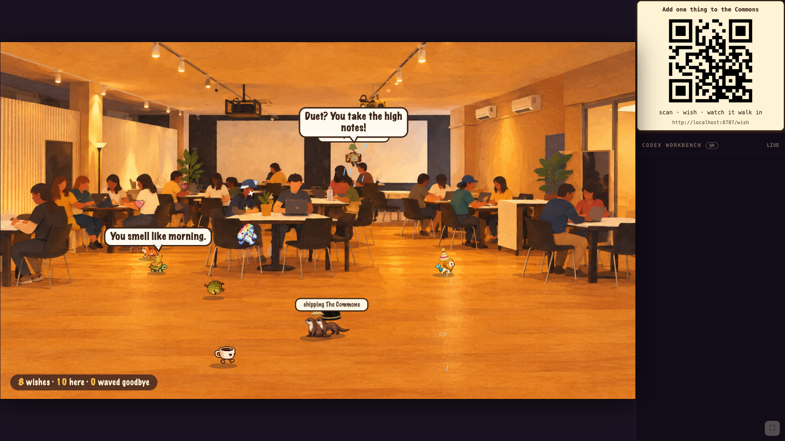
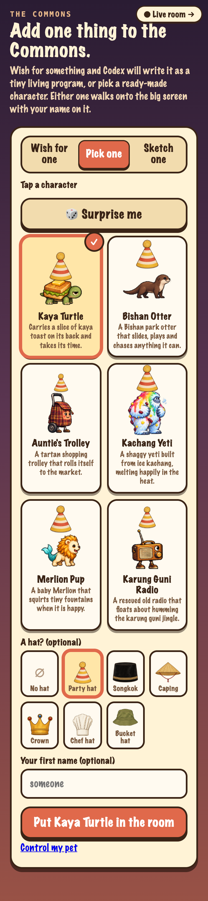
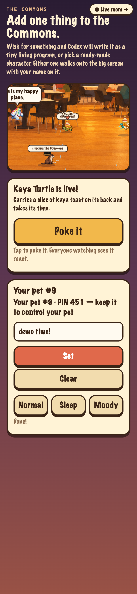

# The Commons: a room that builds itself

**Common Ground Makeathon · Design × Tech · Singapore · 11 Oct 2026**

Everyone in the room scans a QR code and adds one thing: a creature, an object, a pet. **Codex writes it as a small living program, tests it, fixes its own bugs and draws its sprite sheet.** The new thing then walks into a shared world on the projector, credited to the person who wished for it. Point a phone at any room and that room becomes the world.



## Demo video and slides

- 🎬 **Demo video:** [Google Drive](https://drive.google.com/drive/folders/15TLprzAGYpoS4LF6HIbWjBr1fcV32Ekv?usp=sharing). Three formats: 9:16, 16:9 and 1:1. Compressed copies are in [`video/out/`](video/out).
- 🖼️ **Slides:** [`public/slides.html`](public/slides.html). The slides need the server, so after `npm start` open `http://localhost:8787/slides.html`.

## How it works

1. **Scan.** A phone opens `/wish` and offers three ways in:
   - **Wish for one:** you describe it, and Codex writes and tests it.
   - **Pick one:** six Singapore-flavoured presets, plus 🎲 Surprise me.
   - **Sketch one:** a short line; `gpt-6-luna` draws it, and a shared behaviour drives every action.
2. **Watch it get built.** The phone shows each stage live: checking your wish → in the queue → Codex is writing it → testing it → drawing it → **Live!**
3. **It walks in.** The creature drops into the room on the projector. It walks in depth, sits on stools, perches on lamps, reacts to its neighbours and wears your hat.
4. **It's yours.** You get a 3-digit **PIN**. With it you can set a status ("shipping The Commons"), make your pet **sleep** or go **moody**, or **poke** it to trigger its special attack. Clicking a creature on the projector shows who made it.
5. **The Commons grows.** It starts with a single cat, Oyen. When a room fills up at 10 characters, a new room opens.
6. **Any room.** The host photographs the real venue. The photo is redrawn in the house style, and local Codex maps the floor, ceiling and seats. The room switches live.

| Phone | Pet controls | Your room, redrawn |
| --- | --- | --- |
|  |  |  |

## The Codex loop: Codex is the runtime

```
phone ──POST /api/wish──▶ local Codex screening (structured output)
                           │
                           ▼
                    queue (3 at a time)
                           │
          ┌────────────────┴────────────────┐
          ▼                                 ▼
 Codex SDK thread (gpt-6.1-sol)     Codex draws a 12-frame sprite sheet
 writes thing.js                    (gpt-6-luna, image tool)
 runs check-thing.mjs ◀─┐                   │
 reads errors, fixes ───┘                   ▼
          │                         slice-sheet → frames.png + anim.json
          ▼                                 │
 server re-check (authoritative) ◀──────────┘
          │
          ▼
 LIVE → SSE / polling → projector + phones
```

- **Thing contract.** Codex writes a single `thing.js` per creature, at most 6 KB and with no imports.
  - It defines `update` / `onPoke` / `onMeet` / `onSignal` against a small world API: `steer`, `goTo`, `nearby`, `spots`, `fx` and others.
  - The banned list includes `fetch`, timers, the DOM, `eval` and `Math.random`.
  - See [`template/CONTRACT.md`](template/CONTRACT.md).
- **`tools/check-thing.mjs`.** It applies static bans, then simulates 60s of room time in `node:vm` with dummy neighbours. It asserts that every number stays finite and that no call throws or runs too long. Codex reads the `{ok, errors}` output and fixes its own code; nothing goes live until the server's own re-check passes.
- **Unified action map.** Every character uses the same 4×3 sheet: walk ×4, fly ×4, idle, sit, sleep, special. The engine picks frames from the creature's motion, so a creature needs no art-specific code. See [`template/ACTION_MAP.md`](template/ACTION_MAP.md).
- **Room photos.** The OpenAI Images API redraws the photo. Local Codex, given the image as input, returns the walk map: floor trapezoid, air band, ceiling and spots.
- **Local first.** Codex runs through the local CLI on a ChatGPT login. The OpenAI API key is used **only** for redrawing room photos.

Measured on the day: a wish goes from words to a live creature in about 65s, a preset is instant, and a sketch takes about 85s.

## Run it

```bash
npm install
echo "OPENAI_API_KEY=sk-..." > .env       # only needed for room-photo redraws
HOST_KEY=commons-host npm start           # http://localhost:8787
cloudflared tunnel --url http://localhost:8787   # public link for phones
```

This needs the `codex` CLI to be installed and logged in, at `~/.local/bin/codex` or wherever `CODEX_BIN` points.

| Page | What it is |
| --- | --- |
| `/` | Intro: create a room by name, which gives a 4-character code and a host QR |
| `/world` | Projector. Keys: `F` room-only fullscreen, `Q` QR card, `T` timelapse, `←/→` rooms |
| `/join-qr` | Big join QR for a screen |
| `/wish` | Phone: wish, pick or sketch; PIN, status, moods |
| `/host?k=<code>` | Host: photograph the room, adjust the map, go live |
| `/gallery` | Every character and its animation |
| `/slides.html` | Pitch deck |

## Repo map

| Path | What's there |
| --- | --- |
| `server/` | `index.mjs` (http, SSE, API), `queue.mjs`, `codex.mjs`, `screen.mjs`, `animate.mjs`, `scene.mjs`, `store.mjs` |
| `public/` | `engine.js` (simulation and renderer), `world`, `wish`, `host`, `gallery` and slide pages |
| `template/` | Contract, action map, residents, presets, generic behaviour |
| `tools/` | `check-thing.mjs`, `slice-sheet.mjs`, `sprite.mjs`, asset generators |
| `video/` | Brief, original soundtrack generator, motion source, renders |
| `SPEC.md`, `DEMO.md` | Full build spec and demo handoff |

---

The app was built with Claude Code agents. **Codex is the engine inside it:** it screens, writes, tests, fixes and draws every creature, and it maps every room, live, in front of the audience.
